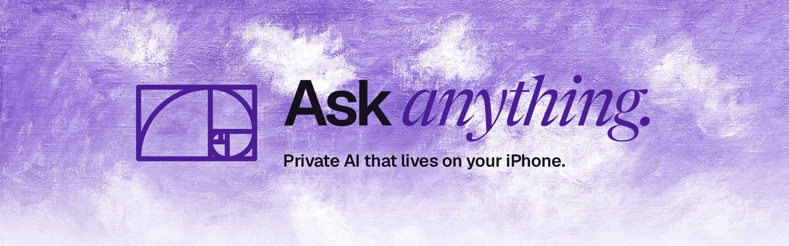
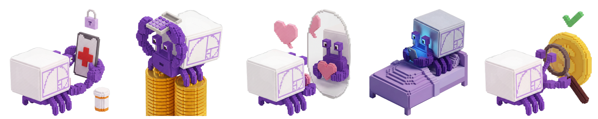

  
  
  
  

## Hermit AI Labs

**We build private intelligence for the device in your pocket.**

Hermit is a language model that runs on your iPhone and nowhere else. It installs once, pulls a quantised open-weight
model over Wi-Fi, and from then on every token is generated on the chip in your hand. There is no inference server,
no account and no prompt log, so privacy is a property of the architecture rather than a promise in a policy. Turn on
flight mode and it keeps answering.

> **The AI is offline. The crypto is online.**
> Reasoning stays on the device. Only a signed transaction, approved with your face, ever leaves it.

### What we are building

| | |
|---|---|
| **On-device inference** | Quantised open-weight models sized for the phone (about 0.5 to 1.5 GB), downloaded once and run fully offline on Apple silicon. |
| **Privacy by construction** | No account, no server-side conversation store, no telemetry on what you ask. Chats are sealed behind Face ID. |
| **Frank by default** | Adult questions get adult answers on health, money, relationships and the ones you would not ask a person. |
| **Hermit Wallet** *(research)* | Keys held in the Secure Enclave, token risk checks computed locally before you buy, swaps gated on Face ID, and agent payments over [x402](https://www.x402.org) and Stripe. |

### Principles

1. **Local first, always.** If a feature needs a server to think, it does not ship.
2. **Nothing to hand over.** Data we never collect cannot be leaked, sold or subpoenaed.
3. **Open weights.** We build on models anyone can inspect.
4. **Small and sharp.** A focused model that answers well beats a large one that asks for your data.

### Repositories

| Repository | What it is |
|---|---|
| [**hermit.my**](https://github.com/Hermit-Ai-Labs/hermit.my) | The public web surface. Dependency-free and hand-tuned: displacement-mapped liquid glass, view-transition theming, a live product stage, served from Cloudflare's edge. |

The iPhone app is in private beta on TestFlight. **[Request an invite →](https://hermit.my)**

© 2026 Hermit AI Labs · iPhone, App Store and TestFlight are trademarks of Apple Inc.
