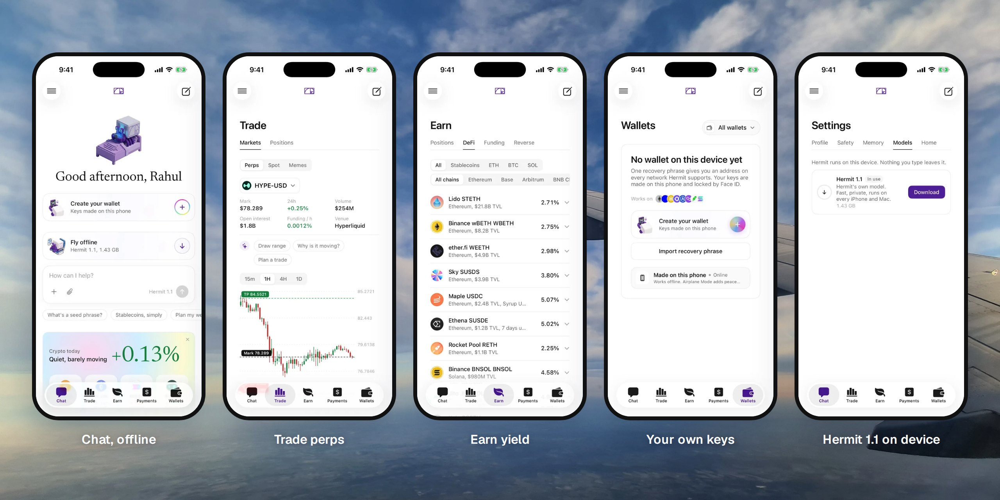

  
  
  
  
  
  

## Hermit

**We build a private agent that is loyal to one person: you.**

Hermit is a wallet for iPhone and Mac with an AI assistant that runs on the device. You ask it in plain words to swap,
bridge, trade or pay. It prepares the move, and nothing leaves your wallet until you approve it with Face ID or Touch
ID. We didn't want our balances and plans on somebody's server, so the model lives on your device. Turn on flight mode
and it keeps answering.

> **The AI is offline. The money is online.**
> Reasoning stays on the device. Only a transaction you approved and signed ever leaves it.

### Try it

- **Mac:** [hermit.my/dmg](https://hermit.my/dmg) (notarized, Apple silicon, macOS 26), or the [Mac beta on TestFlight](https://testflight.apple.com/join/P66H5DF8)
- **iPhone:** [TestFlight beta](https://testflight.apple.com/join/ed9vUh7d)
- **Demo video:** [on X](https://x.com/MrRyanChi/status/2121186366537244978)
- **Docs:** [docs.hermit.my](https://docs.hermit.my)
- **Screens and diagrams:** [hermit.my/gallery](https://hermit.my/gallery)

### What you can ask it

- "Swap 20 USDC on Base to NEAR" opens a review with a NEAR Intents quote.
- "Sell half my BONK" or "long ETH with $50 at 5x" opens the review for that trade.
- Drop in a spreadsheet of addresses and say "pay everyone": one review, one Face ID, on EVM chains or Solana.
- "Every morning at 8, brief me on my portfolio" becomes an automation.
- "What are my positions?" just answers.

### What's inside

| | |
|---|---|
| **Our own models** | We train them ourselves. Hermit 1.3 is our fine-tune of Qwen3-4B and Hermit 1.3 Lite is for smaller iPhones, both taught Hermit's 30 tools on 21,000 examples of real tasks. Open weights on [Hugging Face](https://huggingface.co/aiquantgod). |
| **NEAR at the core** | Swaps and bridges go through NEAR Intents, every wallet has a NEAR account you can stake from, and bigger questions can go to NEAR AI Cloud, but only after the device has checked the enclave's proof. |
| **Black Box** | Every money move the AI prepares and you approve can leave a fingerprint on NEAR, a hash and never the chat, and every Hermit model's hashes are published there for the app to check. [`hermit-blackbox.near`](https://nearblocks.io/address/hermit-blackbox.near) |
| **AI insurance** | 1 USDC for 30 days. If the AI's mistake costs you money, your Black Box record is the proof and approved claims are paid from a public pool on NEAR. [`hermit-insurance.near`](https://nearblocks.io/address/hermit-insurance.near) |
| **Budgets** | Give an agent a small budget with on-chain rules: caps per payment and per day, allowed recipients, standing orders. [`hermit-guard.near`](https://nearblocks.io/address/hermit-guard.near) |
| **Trade and earn** | Perps on Hyperliquid, spot on Solana through Jupiter, Aave deposits, and a browser where web apps see a Hermit wallet. |
| **You approve everything** | The assistant can only prepare. A spending policy and a review you approve sit between it and a signature, and the keys are sealed by the Secure Enclave. |

### Principles

1. **Local first.** If a feature needs our server to think, it doesn't ship.
2. **Nothing to hand over.** Data we never collect can't be leaked, sold or subpoenaed.
3. **Open weights.** Anyone can inspect what runs on their device.
4. **Loyal by design.** The agent works for the person holding the device, and never moves money on its own.

### Repositories

| Repository&nbsp;&nbsp;&nbsp;&nbsp; | What it is |
|---|---|
| [**hermit&#8209;app**](https://github.com/Hermit-Ai-Labs/hermit-app) | The native Mac and iPhone apps in SwiftUI: on-device inference with MLX, the self-custody wallet, trading, earning, payments and automations, plus our three NEAR contracts. |
| [**hermit&#8209;training**](https://github.com/Hermit-Ai-Labs/hermit-training) | How we train our models: the training data, the generators, every test suite with its results, and the recipe. |
| [**hermit.my**](https://github.com/Hermit-Ai-Labs/hermit.my) | The website. |

© 2026 Hermit. <a href="https://hermit.my/terms">Terms</a> · <a href="https://hermit.my/privacy">Privacy</a>. Mac, iPhone, App Store and TestFlight are trademarks of Apple Inc.
